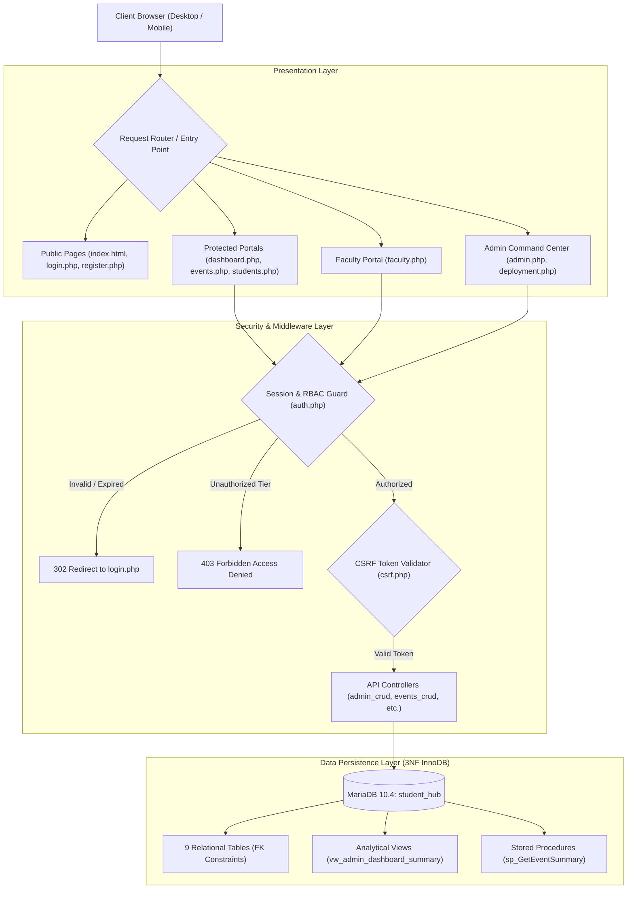
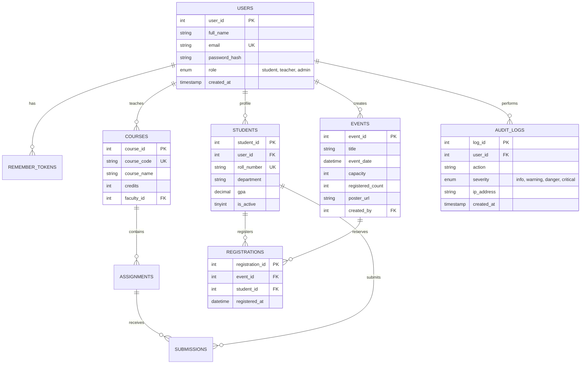

# StudentHub: Full-Stack Enterprise Academic Management Portal

[](https://www.php.net/)
[](https://mariadb.org/)
[-success?style=for-the-badge&logo=mysql&logoColor=white)](student_hub_database.sql)
[-brightgreen?style=for-the-badge&logo=checkmarx&logoColor=white)](tests/test_all_practicals.php)
[](StudentHUB_php/auth.php)
[](https://www.charusat.ac.in/)

> **Charotar University of Science and Technology (CHARUSAT)**  
> **Faculty of Technology and Engineering (FTE) • Department of Computer Engineering**  
> **Course:** Web Development Frameworks (`ITUE203`) • **Practicals:** 7 through 15 Capstone Integration  
> **Repository:** [https://github.com/Yugpatel009/STUDENTHUB.git](https://github.com/Yugpatel009/STUDENTHUB.git)

---

## 📖 Table of Contents
1. [Project Overview](#-project-overview)
2. [Architectural Highlights & Security](#-architectural-highlights--security)
3. [Academic Practical Matrix (P7 – P15)](#-academic-practical-matrix-p7--p15)
4. [Third Normal Form (3NF) Database Topology](#-third-normal-form-3nf-database-topology)
5. [Turnkey Local Deployment Guide](#-turnkey-local-deployment-guide)
6. [Default Verified Seed Credentials](#-default-verified-seed-credentials)
7. [Automated Verification & Master Test Suite](#-automated-verification--master-test-suite)
8. [Directory & File Organization](#-directory--file-organization)
9. [Academic Credits & Authorship](#-academic-credits--authorship)

---

## 🌟 Project Overview

**StudentHub** is a comprehensive, production-grade academic management web application engineered with **PHP 8.2**, **MariaDB/MySQL 10.4**, **Semantic HTML5**, **CSS3 Design Tokens**, and **Vanilla JavaScript**. 

Designed to support higher-education university operations, StudentHub replaces legacy manual administration with modern, asynchronous, role-governed workflows tailored for **Students**, **Faculty Instructors**, and **Super Administrators**.

---

## 🛡️ Architectural Highlights & Security



### Key Technical Capabilities:
- **Strict Role-Based Access Control (RBAC):** Three discrete security tiers (`student`, `teacher`, `admin`) protected by centralized authorization gates (`requireLogin()` and `requireRole()`), generating HTTP 403 Forbidden rejection screens on privilege escalation attempts.
- **Cryptographic Security:** Passwords hashed using `password_hash()` with **Bcrypt (cost factor 10)**. Cross-Site Request Forgery (CSRF) defended with cryptographically secure tokens validated via `hash_equals()`. SQL injection neutralized with parameterized PDO and MySQLi prepared statements.
- **Session Governance:** Automatic session fixation protection (`session_regenerate_id(true)`), 15-minute inactivity timeouts, and persistent authentication via dual-token SHA-256 Remember-Me cookies (30-day expiry).
- **Concurrency & Flat-File Mutex:** Concurrency-safe CSV user synchronization and JSON contact inquiry storage utilizing advisory file locks (`flock()` with `LOCK_EX` / `LOCK_UN`).
- **File Upload Verification:** Secure event poster upload pipeline implementing strict MIME detection via PHP `finfo`, file extension allowlisting (`jpg`, `jpeg`, `png`, `webp`), size limits ($\le 5\text{ MB}$), and automated storage segregation.
- **Responsive Theme Architecture:** 100% Light and Dark theme compatibility utilizing CSS Custom Properties, smooth transitions, and persistent `localStorage` synchronization without Flash of Unstyled Content (FOUC).

---

## 📚 Academic Practical Matrix (P7 – P15)

The codebase implements and automates all requirements defined by the **CHARUSAT ITUE203** syllabus:

| Practical ID | Academic Topic / Focus Area | Key Architectural Modules | Automated Tests |
|:---:|---|---|:---:|
| **Practical 7** | Form Processing, Data Sanitization & File Storage | CSRF token validation, input sanitization, flat-file JSON and CSV persistence with `flock()` mutex. | 5 / 5 Pass |
| **Practical 8** | Database Connectivity & Prepared Statements | Relational MySQL schema creation, PDO database driver, prepared statements, and SQL injection prevention. | 4 / 4 Pass |
| **Practical 9** | User Registration & Password Hashing | Account registration form, Bcrypt password hashing (`cost=10`), duplicate email collision guard, and CSV synchronization. | 7 / 7 Pass |
| **Practical 10** | Session Management, Security & Remember-Me | Session governance, session regeneration, 15-minute inactivity timeout, and SHA-256 dual-token remember-me cookie. | 7 / 7 Pass |
| **Practical 11** | Student Record Management CRUD | Comprehensive student CRUD portal, soft-deletion (`is_active = 0`), GPA numerical filtering, and search pagination. | 6 / 6 Pass |
| **Faculty Portal** | Academic Allocations & Coursework Management | Faculty role authorization, course assignment, student grade auditing, and coursework deadline tracking. | 6 / 6 Pass |
| **Practical 12** | Campus Events & Poster File Uploads | Event management CRUD, poster upload with strict MIME type checking, capacity reservation, and responsive modal lifecycle. | 8 / 8 Pass |
| **Practical 13** | Stored Procedures & RESTful JSON APIs | Transactional stored procedures (`sp_GetEventSummary`), analytical view querying, and RESTful JSON endpoint serialization. | 8 / 8 Pass |
| **Practical 14** | Admin Command Center & Audit Governance | Real-time telemetry, user directory management, RBAC role mutation, last-administrator lockout defense, and automated log retention purge. | 8 / 8 Pass |
| **Practical 15** | Final Integration, Diagnostics & Deployment | Master verification test runner, 3NF schema audit, persistent storage health telemetry, and turnkey deployment packaging. | 8 / 8 Pass |
| **MASTER SUITE** | **Complete Full-Stack Academic Curriculum** | **All 10 Verification Suites Executed Sequentially** | **67 / 67 (100%)** |

---

## 🗄️ Third Normal Form (3NF) Database Topology

The relational database `student_hub` satisfies First Normal Form (1NF), Second Normal Form (2NF), and Third Normal Form (3NF) with zero partial or transitive dependencies:



### Relational Schema Inventory:
1. `users` — Primary account registry, Bcrypt hashes, timestamps, and RBAC roles.
2. `remember_tokens` — SHA-256 hashed persistent login tokens with expiration boundaries.
3. `students` — Academic profiles with GPA tracking and soft-delete (`is_active`) flags.
4. `courses` — Academic curriculum catalog, credit allocations, and assigned faculty IDs.
5. `assignments` — Coursework assignments, submission deadlines, and maximum score metrics.
6. `submissions` — Student coursework submissions, file attachments, and evaluation marks.
7. `events` — Campus hackathons and workshops with seat capacities and poster paths.
8. `registrations` — Transactional student event reservations with seat decrement safeguards.
9. `audit_logs` — Immutable administrative actions, role modifications, client IP, and severity rankings.

### Analytical Database Views & Stored Procedures:
- `vw_admin_dashboard_summary`: Computes high-speed aggregated KPIs across all 9 tables in a single read.
- `vw_admin_monthly_registrations`: Analyzes registration velocity grouped by monthly time-series intervals.
- `sp_GetEventSummary(IN event_id, OUT title, OUT capacity, OUT registered, OUT available)`: Procedure returning event capacity analysis via `OUT` parameters.
- `sp_BulkUpdateEventStatus()`: Transactional batch transition procedure updating past event lifecycle states.
- `sp_RecordAuditLog()`: Transactional security logging procedure recording administrative events into `audit_logs`.

---

## 🚀 Turnkey Local Deployment Guide

### Prerequisites
- **XAMPP for Windows** (or LAMP/MAMP on macOS/Linux) with:
  - **Apache 2.4+** (configured for virtual hosts or web root)
  - **MariaDB 10.4+ / MySQL 8.0+**
  - **PHP 8.1+** (PHP 8.2 recommended with `pdo_mysql`, `mysqli`, `fileinfo`, `openssl`, `mbstring`, `json`, `session` extensions enabled)

---

### Step 1: Clone Repository into XAMPP Web Root
Open your terminal (PowerShell, Command Prompt, or Bash) and clone into `htdocs`:
```bash
cd C:\xampp\htdocs
git clone https://github.com/Yugpatel009/STUDENTHUB.git STUDENTHUB
cd STUDENTHUB
```

### Step 2: Environment Configuration
Copy the template configuration file:
```bash
cp .env.example .env
```
Ensure your database parameters in `.env` match your local MySQL configuration:
```ini
DB_HOST=127.0.0.1
DB_PORT=3306
DB_NAME=student_hub
DB_USER=root
DB_PASS=
APP_ENV=production
APP_DEBUG=false
```

### Step 3: Database Import & View Synchronization
Initialize the database and import the unified 3NF schema with stored procedures and views:
```bash
# Using MySQL CLI:
mysql -u root -p -e "CREATE DATABASE IF NOT EXISTS student_hub CHARACTER SET utf8mb4 COLLATE utf8mb4_unicode_ci;"
mysql -u root -p student_hub < student_hub_database.sql
```
*(Alternatively, open phpMyAdmin at `http://localhost/phpmyadmin`, create a database named `student_hub`, and import [`student_hub_database.sql`](student_hub_database.sql)).*

### Step 4: Run Automated Master Test Suite
Validate that your deployment is 100% operational:
```bash
php tests/test_all_practicals.php
```
You should see:
```text
Final Build Verdict: 100% ALL PRACTICALS VERIFIED! READY FOR SUBMISSION 🚀
```

### Step 5: Launch in Browser
Open your browser to:
👉 **`http://localhost/STUDENTHUB/Pages/login.php`**

---

## 🔑 Default Verified Seed Credentials

The database is pre-seeded with verified test accounts across all roles (passwords hashed via Bcrypt):

| Role Tier | Full Name | Email Address | Default Password | Initial Accessible Portals |
|---|---|---|---|---|
| **Super Administrator** | Admin Officer | `admin@charusat.edu.in` | `Password@123` | Dashboard, Admin Command Center, Diagnostics & Deployment, All CRUD Portals |
| **Faculty Member** | Dr. Rajesh Patel | `rajesh.patel@charusat.edu.in` | `Password@123` | Faculty Portal, Course Assignments, Events, Student Marks |
| **Student** | Aarav Sharma | `aarav.sharma@charusat.edu.in` | `Password@123` | Student Dashboard, Event Registrations, Assignments, Attendance, Results |

---

## 🧪 Automated Verification & Master Test Suite

StudentHub includes a built-in automated test suite covering all modules without requiring external test frameworks.

### Execute Master Test Runner (Practicals 7 – 15):
```bash
php tests/test_all_practicals.php
```

### Execute Practical 15 Integration Suite:
```bash
php tests/test_practical15.php
```

### Execute Database Diagnostics:
```bash
php test_db.php
```

### Interactive Web Console:
Administrators can execute tests asynchronously from the browser:
1. Log in as `admin@charusat.edu.in`.
2. Navigate to **Diagnostics & Deploy (P15)** (`Pages/deployment.php`).
3. Click **"Execute Master Test Suite"** to stream live test execution directly into the web terminal.

```text
====================================================================
 MASTER TEST EXECUTION SUMMARY REPORT
====================================================================
Suite    | Status | Module Description
--------------------------------------------------------------------
P7       | PASS   | Practical 7: Form Sanitization, CSRF & File Storage (JSON/CSV)
P8       | PASS   | Practical 8: Relational Schema, PDO & Stored Procedures
P9       | PASS   | Practical 9: User Registration, Bcrypt Hashing & Duplicate Email Guard
P10      | PASS   | Practical 10: Secure Login, Sessions, Inactivity Timeout & Remember-Me
P11      | PASS   | Practical 11: Student Management CRUD & Soft-Delete Architecture
FP       | PASS   | Faculty Portal: Course & Student Academic Record Management
P12      | PASS   | Practical 12: Campus Event CRUD & Verified File/Poster Upload
P13      | PASS   | Practical 13: RESTful JSON API & Asynchronous Fetch CRUD
P14      | PASS   | Practical 14: Admin Command Center, Telemetry, RBAC & Audit Trail
P15      | PASS   | Practical 15: Final System Integration, Views & Deployment Verification
--------------------------------------------------------------------
Total Test Suites: 10 | Suites Passed: 10 | Suites Failed: 0
Execution Duration: 1.89 seconds
Final Build Verdict: 100% ALL PRACTICALS VERIFIED! READY FOR SUBMISSION 🚀
====================================================================
```

---

## 📁 Directory & File Organization

```text
STUDENTHUB/
├── .env.example                     # Environment deployment configuration template
├── .gitignore                       # Git ignore rules for secrets, locks, and cache
├── README.md                        # Master repository documentation (this file)
├── student_hub_database.sql         # Complete 3NF MySQL database export
├── test_db.php                      # Database connectivity diagnostic audit tool
├── index.html                       # Public landing page
│
├── Pages/                           # Frontend Presentation Layer
│   ├── login.php                    # Server-rendered login portal
│   ├── register.php                 # Server-rendered registration portal
│   ├── dashboard.php                # Unified student/faculty dashboard
│   ├── admin.php                    # Practical 14: Admin Command Center & Audit Trail
│   ├── deployment.php               # Practical 15: Deployment & System Diagnostics
│   ├── faculty.php                  # Faculty Portal: Course & Student Management
│   ├── events.php                   # Practical 12: Campus Events & Poster Uploads
│   ├── students.php                 # Practical 11: Student Directory & Soft Delete CRUD
│   ├── courses.php                  # Academic Course Catalog
│   ├── assignment.php               # Coursework Assignments
│   ├── attendance.php               # Student Attendance Tracker
│   ├── result.php                   # Examination Results & Academic Performance
│   ├── profile.php                  # User Profile Management
│   └── contact.html                 # Public Inquiry & Feedback Page
│
├── StudentHUB_php/                  # Backend Middleware, APIs & Controllers
│   ├── auth.php                     # Authentication, RBAC gates, and session init
│   ├── csrf.php                     # CSRF token generation and validation
│   ├── db.php                       # MySQLi & PDO database connections
│   ├── audit.php                    # Centralized security audit logging engine
│   ├── login.php                    # Login authentication handler
│   ├── logout.php                   # Secure session termination & cookie purge
│   ├── register.php                 # User registration handler
│   ├── admin_crud.php               # Admin API (user roles, telemetry, audit purge)
│   ├── deployment_api.php           # Practical 15 asynchronous test runner API
│   ├── events_crud.php              # Event CRUD & image poster validation
│   ├── students_crud.php            # Student CRUD & GPA filter API
│   ├── courses_crud.php             # Course catalog API
│   ├── contact.php                  # Contact form persistence (CSV/JSON mutex)
│   ├── registered_users.csv         # Flat-file user registry backup
│   └── contact_messages.json        # Flat-file inquiries storage
│
├── tests/                           # Automated Verification Test Suites
│   ├── test_all_practicals.php      # Master verification test runner (all 10 suites)
│   ├── test_practical15.php         # Practical 15 unit & integration tests
│   ├── test_practical14.php         # Practical 14 admin center tests
│   ├── test_practical13.php         # Practical 13 API & stored procedure tests
│   ├── test_practical12.php         # Practical 12 event CRUD & upload tests
│   ├── test_faculty_crud.php        # Faculty portal tests
│   ├── test_practical11.php         # Practical 11 student CRUD tests
│   ├── test_practical10.php         # Practical 10 session & timeout tests
│   ├── test_practical9.php          # Practical 9 password hashing tests
│   ├── test_practical8.php          # Practical 8 database & PDO tests
│   └── test_practical7.php          # Practical 7 form & CSRF tests
│
├── css/                             # Stylesheets with Theme Tokens
│   ├── style.css                    # Global typography, pill nav, and theme tokens
│   ├── admin.css                    # Admin Command Center layout
│   ├── deployment.css               # Deployment & Diagnostics styling
│   ├── faculty.css                  # Faculty portal styling
│   ├── events.css                   # Campus events & modal styling
│   └── login.css                    # Authentication card styling
│
├── js/                              # Frontend Interactive Scripts
│   └── script.js                    # Mobile drawer, theme toggles, and utilities
│
├── uploads/                         # User Upload Storage
│   └── events/                      # Event poster storage (.gitkeep preserved)
│
└── submission/                      # Academic Laboratory Manuals & Reports
    ├── D26DCE141_LAB_4-15_WDF.docx  # Complete university lab journal (Practicals 4–15)
    └── Practical_15_D26DCE141.docx  # Standalone Practical 15 lab report
```

---

## 🎓 Academic Credits & Authorship

- **Institution:** Charotar University of Science and Technology (CHARUSAT)
- **Faculty:** Faculty of Technology and Engineering (FTE)
- **Program:** Bachelor of Technology in Computer Engineering
- **Course Title:** Web Development Frameworks (`ITUE203`)
- **Student Candidate:** `D26DCE141`
- **GitHub Repository:** [Yugpatel009/STUDENTHUB](https://github.com/Yugpatel009/STUDENTHUB.git)

---

## 📄 License
This project is developed for educational and academic assessment purposes under the **MIT License**. All rights reserved © 2026 StudentHub Engineering Team.
