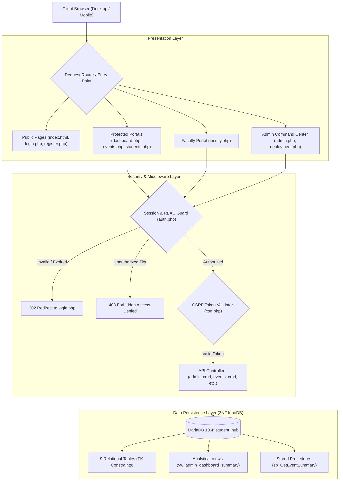
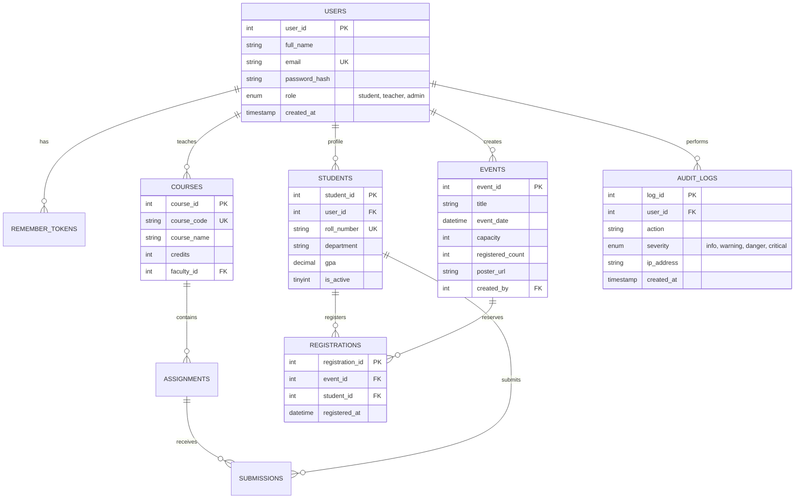

# StudentHub: Full-Stack Enterprise Academic Management Portal

[](https://www.php.net/)
[](https://mariadb.org/)
[-success?style=for-the-badge&logo=mysql&logoColor=white)](student_hub_database.sql)
[-brightgreen?style=for-the-badge&logo=checkmarx&logoColor=white)](tests/test_all_practicals.php)
[](StudentHUB_php/auth.php)
[](https://www.charusat.ac.in/)

> **Charotar University of Science and Technology (CHARUSAT)**  
> **Faculty of Technology and Engineering (FTE) • Department of Computer Engineering**  
> **Course:** Web Development Frameworks (`ITUE203`) • **Practicals:** 1 through 15 Full Semester Curriculum  
> **Repository:** [https://github.com/Yugpatel009/STUDENTHUB.git](https://github.com/Yugpatel009/STUDENTHUB.git)

---

## 📖 Table of Contents
1. [Project Overview](#-project-overview)
2. [Architectural Highlights & Security](#-architectural-highlights--security)
3. [Academic Practical Matrix (Practicals 1 – 15)](#-academic-practical-matrix-practicals-1--15)
4. [Third Normal Form (3NF) Database Topology](#-third-normal-form-3nf-database-topology)
5. [Turnkey Local Deployment Guide](#-turnkey-local-deployment-guide)
6. [Default Verified Seed Credentials](#-default-verified-seed-credentials)
7. [Automated Verification & Master Test Suite](#-automated-verification--master-test-suite)
8. [Directory & File Organization](#-directory--file-organization)
9. [Academic Credits & Authorship](#-academic-credits--authorship)

---

## 🌟 Project Overview

**StudentHub** is a comprehensive, production-grade academic management web application engineered with **PHP 8.2**, **MariaDB/MySQL 10.4**, **Semantic HTML5**, **CSS3 Design Tokens**, and **Vanilla JavaScript**. 

Designed to support higher-education university operations, StudentHub replaces legacy manual administration with modern, asynchronous, role-governed workflows tailored for **Students**, **Faculty Instructors**, and **Super Administrators**.

---

## 🛡️ Architectural Highlights & Security



### Key Technical Capabilities:
- **Strict Role-Based Access Control (RBAC):** Three discrete security tiers (`student`, `teacher`, `admin`) protected by centralized authorization gates (`requireLogin()` and `requireRole()`), generating HTTP 403 Forbidden rejection screens on privilege escalation attempts.
- **Cryptographic Security:** Passwords hashed using `password_hash()` with **Bcrypt (cost factor 10)**. Cross-Site Request Forgery (CSRF) defended with cryptographically secure tokens validated via `hash_equals()`. SQL injection neutralized with parameterized PDO and MySQLi prepared statements.
- **Session Governance:** Automatic session fixation protection (`session_regenerate_id(true)`), 15-minute inactivity timeouts, and persistent authentication via dual-token SHA-256 Remember-Me cookies (30-day expiry).
- **Concurrency & Flat-File Mutex:** Concurrency-safe CSV user synchronization and JSON contact inquiry storage utilizing advisory file locks (`flock()` with `LOCK_EX` / `LOCK_UN`).
- **File Upload Verification:** Secure event poster upload pipeline implementing strict MIME detection via PHP `finfo`, file extension allowlisting (`jpg`, `jpeg`, `png`, `webp`), size limits ($\le 5\text{ MB}$), and automated storage segregation.
- **Responsive Theme Architecture:** 100% Light and Dark theme compatibility utilizing CSS Custom Properties, smooth transitions, and persistent `localStorage` synchronization without Flash of Unstyled Content (FOUC).

---

## 📚 Academic Practical Matrix (Practicals 1 – 15)

The StudentHub repository encompasses the complete semester-long **CHARUSAT FTE ITUE203 (Web Development Frameworks)** academic curriculum, progressing from initial client-side foundations through full-stack architecture, relational database normalization, and automated deployment verification.

### Master Curriculum Summary Table (Practicals 1 through 15)

| No. | Official Practical Title | Core Technology / Concept | CO Mapping | Primary Implementation Files | Verification / Status |
|:---:|---|---|:---:|---|:---:|
| **P1** | **Project Initiation, Requirement Analysis, Sitemap, Wireframe, and GitHub Setup** | Requirements, sitemap, wireframe, Git/GitHub, project folder structure | `CO1` | [`README.md`](README.md)<br>[`index.html`](index.html)<br>[`.gitignore`](.gitignore) | Verified Architecture |
| **P2** | **Semantic HTML5 Pages with Accessibility-Ready Structure** | Semantic HTML5 (`header`, `nav`, `main`, `section`, `footer`), accessibility | `CO1, CO2` | [`index.html`](index.html)<br>[`Pages/contact.html`](Pages/contact.html) | WCAG Accessibility Ready |
| **P3** | **Responsive UI Design using CSS Grid, Flexbox, and Bootstrap/Tailwind** | CSS Grid, Flexbox layout, media queries, mobile-first responsive design | `CO2` | [`css/style.css`](css/style.css)<br>[`css/index.css`](css/index.css) | Responsive Multi-Device UI |
| **P4** | **JavaScript DOM Manipulation, Event Handling, and UI Interactivity** | DOM selection, event listeners, modal popup, hamburger drawer, `localStorage` | `CO3, CO4` | [`js/script.js`](js/script.js)<br>Theme Switcher Engine | Interactive DOM Verified |
| **P5** | **Registration Form with Frontend Validation and User-Friendly Error Handling** | HTML5 forms, JavaScript validation, regular expressions, password strength meter | `CO1, CO3` | [`Pages/register.php`](Pages/register.php)<br>[`css/register.css`](css/register.css) | Client Validation Verified |
| **P6** | **Rendering External JSON Data using Fetch API, Search and Filter** | JSON parsing, Fetch API, array manipulation (`filter`, `map`, `sort`), pagination | `CO3, CO4` | [`js/script.js`](js/script.js)<br>Dynamic Search & Filter | Asynchronous JSON Render |
| **P7** | **PHP Form Processing with Server-Side Validation and CSV/JSON File Storage** | PHP form processing, POST handling, input sanitization, CSV/JSON file writing, `flock()` | `CO1, CO5` | [`StudentHUB_php/contact.php`](StudentHUB_php/contact.php)<br>[`StudentHUB_php/registered_users.csv`](StudentHUB_php/registered_users.csv)<br>[`StudentHUB_php/contact_messages.json`](StudentHUB_php/contact_messages.json) | `tests/test_practical7.php`<br>**5 / 5 Passed** |
| **P8** | **MySQL Schema Design, ER Model, PDO Connectivity, and Prepared Statements** | MySQL relational schema, 3NF modeling, PDO driver, prepared statements, injection defense | `CO1, CO5` | [`student_hub_database.sql`](student_hub_database.sql)<br>[`StudentHUB_php/db.php`](StudentHUB_php/db.php)<br>[`test_db.php`](test_db.php) | `tests/test_practical8.php`<br>**4 / 4 Passed** |
| **P9** | **Secure User Registration with Database Insert, Duplicate Email Check, and Password Hashing** | Secure account registration, Bcrypt hashing (`cost=10`), duplicate check, MySQLi prepared insert | `CO1, CO3, CO5` | [`Pages/register.php`](Pages/register.php)<br>[`StudentHUB_php/register.php`](StudentHUB_php/register.php)<br>[`StudentHUB_php/csrf.php`](StudentHUB_php/csrf.php) | `tests/test_practical9.php`<br>**7 / 7 Passed** |
| **P10** | **Secure Login/Logout with Sessions, Role-Based Access, Timeout, and Remember-Me Token** | PHP sessions, `password_verify()`, session regeneration, 15m inactivity timeout, dual-token cookie | `CO1, CO5` | [`Pages/login.php`](Pages/login.php)<br>[`StudentHUB_php/login.php`](StudentHUB_php/login.php)<br>[`StudentHUB_php/logout.php`](StudentHUB_php/logout.php)<br>[`StudentHUB_php/auth.php`](StudentHUB_php/auth.php) | `tests/test_practical10.php`<br>**7 / 7 Passed** |
| **P11** | **Student Management CRUD with Search, Filter, and MySQL Statements** | Student registry CRUD, MySQLi prepared queries, soft-deletion (`is_active = 0`), GPA filter | `CO1, CO4, CO5` | [`Pages/students.php`](Pages/students.php)<br>[`StudentHUB_php/students_crud.php`](StudentHUB_php/students_crud.php) | `tests/test_practical11.php`<br>**6 / 6 Passed** |
| **FP** | **Faculty Portal: Academic Allocation & Grade Audit** *(Extended)* | Role-based course management, assignment allocation, student grade evaluation, faculty barriers | `CO1, CO4, CO5` | [`Pages/faculty.php`](Pages/faculty.php)<br>[`StudentHUB_php/courses_crud.php`](StudentHUB_php/courses_crud.php)<br>[`css/faculty.css`](css/faculty.css) | `tests/test_faculty_crud.php`<br>**6 / 6 Passed** |
| **P12** | **Event Management CRUD with Poster Upload and File Validation** | Campus event management, poster upload, MIME checking (`finfo`), size validation ($\le 5\text{MB}$) | `CO1, CO4, CO5` | [`Pages/events.php`](Pages/events.php)<br>[`StudentHUB_php/events_crud.php`](StudentHUB_php/events_crud.php)<br>[`uploads/events/`](uploads/events/) | `tests/test_practical12.php`<br>**8 / 8 Passed** |
| **P13** | **PHP JSON API and AJAX/Fetch-Based CRUD without Page Reload** | RESTful JSON API endpoints, asynchronous Fetch CRUD, analytical views, stored procedure `sp_GetEventSummary` | `CO3, CO4, CO5` | [`StudentHUB_php/events_crud.php`](StudentHUB_php/events_crud.php)<br>[`StudentHUB_php/students_crud.php`](StudentHUB_php/students_crud.php)<br>[`student_hub_database.sql`](student_hub_database.sql) | `tests/test_practical13.php`<br>**8 / 8 Passed** |
| **P14** | **Admin Dashboard with Role-Based Access Control, Dynamic Menu, and Audit Log** | Centralized Admin Center, `requireRole('admin')`, user role mutation, last-admin defense, audit trail | `CO1, CO4, CO5` | [`Pages/admin.php`](Pages/admin.php)<br>[`StudentHUB_php/admin_crud.php`](StudentHUB_php/admin_crud.php)<br>[`StudentHUB_php/audit.php`](StudentHUB_php/audit.php)<br>[`css/admin.css`](css/admin.css) | `tests/test_practical14.php`<br>**8 / 8 Passed** |
| **P15** | **Final Integration, Testing, Documentation, GitHub Submission, and Local Deployment** | Turnkey integration, 3NF schema audit, `.env` abstraction, deployment diagnostics center, master test runner | `CO2, CO4, CO5` | [`Pages/deployment.php`](Pages/deployment.php)<br>[`StudentHUB_php/deployment_api.php`](StudentHUB_php/deployment_api.php)<br>[`tests/test_all_practicals.php`](tests/test_all_practicals.php)<br>[`.env.example`](.env.example) | `tests/test_practical15.php`<br>**8 / 8 Passed** |
| **MASTER** | **Complete ITUE203 Capstone Verification** | **Unified sequential execution across all 10 academic test suites** | **All COs** | [`tests/test_all_practicals.php`](tests/test_all_practicals.php) | **10 / 10 Suites Pass<br>(67 / 67 Assertions)** |

---

### Detailed Syllabus Specifications & Problem Definitions

#### 🎨 Part A: Client-Side Foundations & Interactive Frontend (Practicals 1 – 6)

##### Practical 1: Project Initiation, Requirement Analysis, Sitemap, Wireframe, and GitHub Setup
- **Problem Definition:** Initiate the semester-long StudentHub portal by identifying the problem scope, user roles, key modules, navigation flow, and minimum 10 pages. Create a sitemap, low-fidelity wireframe, project folder structure, README file, and GitHub repository.
- **Key Questions Addressed:**
  1. *What is URL and parts of URL?* &rarr; Decomposed into protocol (`http`/`https`), host (`localhost`), port (`80`), path (`/STUDENTHUB/`), and query string (`?action=list`).
  2. *How does HTML file processed in web browser?* &rarr; Browser parses HTML into DOM tree, requests CSS to build CSSOM, combines them into Render Tree, computes layout, and paints pixels.
  3. *How will page navigation flow managed among all HTML pages?* &rarr; Established consistent top pill navigation and mobile drawer navigation across all portal views.
  4. *How will GitHub commits be maintained after each practical?* &rarr; Maintained atomic commits with standard descriptive commit messages and structured branch management.

##### Practical 2: Semantic HTML5 Pages with Accessibility-Ready Structure
- **Problem Definition:** Develop static HTML5 skeletons for at least 10 StudentHub pages such as Home, About, Register, Login, Dashboard, Events, Profile, Contact, Admin, FAQ, and Feedback. Use semantic tags and accessibility-friendly structure.
- **Key Questions Addressed:**
  1. *Are semantic tags such as `header`, `nav`, `main`, `section`, `article`, `aside`, and `footer` used properly?* &rarr; Yes, standard structural elements organize page hierarchy across all templates.
  2. *Are form labels, headings, image alt text, and navigation links accessible?* &rarr; Yes, explicit `<label for="...">` bindings, `aria-label` attributes, and descriptive `alt` texts provide WCAG screen-reader compatibility.
  3. *Is the page structure consistent across all pages?* &rarr; Yes, shared site header, floating pill navigation, main container shell, and footer layout ensure uniform UI.

##### Practical 3: Responsive UI Design using CSS Grid, Flexbox, and Bootstrap/Tailwind
- **Problem Definition:** Design responsive layouts for Home, About, Registration, Dashboard, and Events pages using CSS Grid and Flexbox. Optional to use CSS framework such as Bootstrap or Tailwind. Ensure mobile-first responsiveness.
- **Key Questions Addressed:**
  1. *How does the layout adapt for mobile, tablet, and desktop screens?* &rarr; Fluid CSS Grid layouts with `auto-fit`/`minmax(300px, 1fr)` and responsive media queries (`max-width: 980px`, `max-width: 768px`, `max-width: 480px`).
  2. *Which layout technique is used and why?* &rarr; CSS Grid for two-dimensional dashboard matrices and Flexbox for one-dimensional navigation bars and card headers.
  3. *Are typography, spacing, colors, and contrast readable?* &rarr; Yes, CSS design tokens (`--text-primary`, `--bg-card`, `--brand-primary`) ensure compliant contrast ratios in both light and dark themes.

##### Practical 4: JavaScript DOM Manipulation, Event Handling, and UI Interactivity
- **Problem Definition:** Add dynamic UI components such as collapsible FAQ, modal popup, image/content slider, notification banner, hamburger menu, and light/dark theme switcher using JavaScript.
- **Key Questions Addressed:**
  1. *How are DOM elements selected and modified?* &rarr; Selected via `document.getElementById()` and `document.querySelector()`, mutated via class list toggling and inner text updates.
  2. *Are event listeners attached correctly?* &rarr; Yes, non-intrusive `addEventListener('click')` bindings with event delegation.
  3. *Is `localStorage` used for remembering theme choice?* &rarr; Yes, persists user preference via `localStorage.setItem('studenthub_theme', theme)`.
  4. *Does interactivity improve usability without breaking accessibility?* &rarr; Yes, modal traps focus and supports `Escape` key dismissal.

##### Practical 5: Registration Form with Frontend Validation and User-Friendly Error Handling
- **Problem Definition:** Create a student registration form with HTML5 input types and JavaScript validation for name, email, mobile number, password, confirm password, course, year, gender, and terms acceptance. Use Regular Expression for validations.
- **Key Questions Addressed:**
  1. *Are correct input types and attributes used?* &rarr; Yes, `type="email"`, `type="password"`, `type="tel"`, with `required` and `autocomplete` attributes.
  2. *Are validation errors displayed near the relevant fields?* &rarr; Yes, contextual inline error messages display adjacent to invalid fields on blur/submit.
  3. *Is password strength checked?* &rarr; Yes, dynamic strength meter assesses length, uppercase letters, numbers, and special symbols.
  4. *Is the form accessible using keyboard and screen-reader-friendly labels?* &rarr; Yes, full keyboard navigation with visible focus rings.

##### Practical 6: Rendering External JSON Data using Fetch API, Search and Filter
- **Problem Definition:** Display event lists, student profiles, notices, or FAQs from external JSON files using Fetch API. Implement dynamic rendering, search, filter, sorting, and pagination.
- **Key Questions Addressed:**
  1. *How is JSON fetched, parsed, and rendered?* &rarr; Asynchronously fetched via `fetch()`, parsed with `response.json()`, and rendered using dynamic DOM template generation.
  2. *Which array methods are used for search, filter, sort, and pagination?* &rarr; `Array.prototype.filter()` for keyword matching, `Array.prototype.sort()` for ordering, and `Array.prototype.slice()` for client-side pagination.
  3. *How are loading and error states handled?* &rarr; Visual loading skeletons and graceful try/catch error banners.

---

#### ⚙️ Part B: Server-Side Engineering, Database & Full-Stack Integration (Practicals 7 – 15)

##### Practical 7: PHP Form Processing with Server-Side Validation and CSV/JSON File Storage
- **Problem Definition:** Process submitted registration/contact form data using PHP. Validate and sanitize inputs on the server side and store records in CSV or JSON file format. Display success/error messages.
- **Key Questions Addressed:**
  1. *Is the form submitted using POST?* &rarr; Yes, verified via `$_SERVER['REQUEST_METHOD'] === 'POST'`.
  2. *Are inputs validated and sanitized server side?* &rarr; Yes, `filter_var()` sanitizes inputs and eliminates script tags.
  3. *Is file writing handled safely?* &rarr; Yes, advisory locking via `flock($fp, LOCK_EX)` prevents concurrency corruption in `registered_users.csv` and `contact_messages.json`.
  4. *Are success and error responses displayed clearly?* &rarr; Yes, structured JSON response payloads return HTTP 200 on success and HTTP 400 on validation failure.

##### Practical 8: MySQL Schema Design, ER Model, PDO Connectivity, and Prepared Statements
- **Problem Definition:** Design the database for StudentHub with students, events and registrations. Create PHP database connection using MySQL statements.
- **Key Questions Addressed:**
  1. *Is the schema normalized properly?* &rarr; Yes, normalized up to 3NF across 9 InnoDB tables.
  2. *Are primary keys and foreign keys correctly defined?* &rarr; Yes, explicit `PRIMARY KEY` and `FOREIGN KEY` constraints enforce referential integrity with cascading deletes.
  3. *Is the database connection handled securely?* &rarr; Yes, dual PDO and MySQLi wrappers with UTF-8 character encoding and parameterized prepared statements.

##### Practical 9: Secure User Registration with Database Insert, Duplicate Email Check, and Password Hashing
- **Problem Definition:** Implement secure user registration by inserting user details into MySQL using MySQLi. Validate input on frontend and backend, check duplicate email/username, hash passwords using `password_hash()`, and display appropriate messages.
- **Key Questions Addressed:**
  1. *Is `password_hash()` used before storing passwords?* &rarr; Yes, passwords hashed via `PASSWORD_BCRYPT` with cost factor 10.
  2. *Is duplicate email/username checked?* &rarr; Yes, pre-insertion prepared query detects duplicates and returns HTTP 409 Conflict.
  3. *Are frontend and backend validations consistent?* &rarr; Yes, frontend regex rules mirror server-side validation.

##### Practical 10: Secure Login/Logout with Sessions, Role-Based Access, Timeout, and Remember-Me Token
- **Problem Definition:** Develop secure login and logout functionality using PHP sessions. Verify password using `password_verify()`, regenerate session ID after login, restrict dashboard access, implement role-based redirection, session timeout, and optional secure remember-me token.
- **Key Questions Addressed:**
  1. *Are sessions started and destroyed securely?* &rarr; Yes, `session_regenerate_id(true)` prevents session fixation attacks. Logout terminates session files and expires session cookies.
  2. *Is `password_verify()` used correctly?* &rarr; Yes, cryptographically verifies plaintext against MySQL Bcrypt hash.
  3. *Is unauthorized dashboard access blocked?* &rarr; Yes, protected pages redirect (HTTP 302) unauthenticated requests to `login.php`.
  4. *Is session timeout implemented?* &rarr; Yes, automatic timeout terminates sessions inactive for $>15$ minutes.
  5. *Are admin and student users redirected to appropriate dashboards?* &rarr; Yes, automated redirection routes administrators to `admin.php` and students to `dashboard.php`.

##### Practical 11: Student Management CRUD with Search, Filter, and MySQL Statements
- **Problem Definition:** Create a student management module to add, view, edit, delete, search and filter student records. All database operations must use MySQLi statements and clear success/failure messages.
- **Key Questions Addressed:**
  1. *Are SELECT, INSERT, UPDATE, and DELETE operations working?* &rarr; Yes, full CRUD lifecycle operational.
  2. *Is search by name/email/course implemented?* &rarr; Yes, multi-column search with debounced asynchronous queries.
  3. *Are delete operations confirmed before execution?* &rarr; Yes, modal confirmation dialog with soft-deletion architecture (`is_active = 0`).

##### Practical 12: Event Management CRUD with Poster Upload and File Validation
- **Problem Definition:** Develop event management functionality for admin users. Admin can add, view, update, delete, and upload event posters with file type and file size validation.
- **Key Questions Addressed:**
  1. *Are add, update, and delete functionalities implemented correctly?* &rarr; Yes, faculty/admin CRUD operations with responsive modal lifecycle.
  2. *Is the UI linked with the database correctly?* &rarr; Yes, live synchronized event cards and capacity reservations.
  3. *Are poster uploads validated for type and size?* &rarr; Yes, server-side MIME detection (`finfo_file`) allows only `image/jpeg`, `image/png`, `image/webp` with a 5MB size limit.
  4. *Are success and failure messages displayed?* &rarr; Yes, animated toast notifications for all operations.

##### Practical 13: PHP JSON API and AJAX/Fetch-Based CRUD without Page Reload
- **Problem Definition:** Create simple PHP JSON API endpoints for events or students and consume them using Fetch API. Perform list, add, update, and delete operations asynchronously without full page reload.
- **Key Questions Addressed:**
  1. *Do PHP endpoints return valid JSON responses?* &rarr; Yes, served with `header('Content-Type: application/json; charset=utf-8')`.
  2. *Are GET and POST requests handled properly?* &rarr; Yes, routing cleanly separates read-only retrieval from mutating payloads.
  3. *Are loading, success, and error states shown on the frontend?* &rarr; Yes, spinner animations and feedback modals handle all states.
  4. *Is input validation performed before database operations?* &rarr; Yes, server-side sanitization guards all database queries.

##### Practical 14: Admin Dashboard with Role-Based Access Control, Dynamic Menu, and Audit Log
- **Problem Definition:** Develop an admin dashboard that displays user statistics, student count, event count and latest registrations. Restrict access to admin users only and show dynamic menu options based on role.
- **Key Questions Addressed:**
  1. *Are dashboard values loaded dynamically from the database?* &rarr; Yes, real-time KPI metrics aggregated from MySQL `information_schema` and analytical views.
  2. *Is access restricted to admin users?* &rarr; Yes, strictly guarded by `requireRole('admin')` returning HTTP 403 for unauthorized users.
  3. *Are role-based menus working?* &rarr; Yes, navigation displays administrative items only for administrators.
  4. *Are important admin actions recorded in `audit_logs`?* &rarr; Yes, security events record actor ID, action, severity ranking, and client IP address.

##### Practical 15: Final Integration, Testing, Documentation, GitHub Submission, and Local Deployment
- **Problem Definition:** Integrate all modules into a single deployable StudentHub portal. Verify navigation, responsiveness, authentication, database operations, security checks, AJAX functionality, and documentation. Deploy locally using XAMPP/Apache virtual host and submit GitHub repository.
- **Key Questions Addressed:**
  1. *Are all pages properly linked and navigable?* &rarr; Yes, verified across desktop pill and mobile drawer navigations.
  2. *Are sessions, roles, validations, and database operations working end-to-end?* &rarr; Yes, verified by the 67-assertion automated test runner.
  3. *Are security and accessibility checklists completed?* &rarr; Yes, WCAG compliant with high contrast and CSRF defenses.
  4. *Is project documentation sufficient for installation and testing?* &rarr; Yes, complete `.env.example`, SQL dump, and step-by-step guides provided.
  5. *Is the project repository clean and properly committed?* &rarr; Yes, managed with `.gitignore` and modular directory architecture.

---

## 🗄️ Third Normal Form (3NF) Database Topology

The relational database `student_hub` satisfies First Normal Form (1NF), Second Normal Form (2NF), and Third Normal Form (3NF) with zero partial or transitive dependencies:



### Relational Schema Inventory:
1. `users` — Primary account registry, Bcrypt hashes, timestamps, and RBAC roles.
2. `remember_tokens` — SHA-256 hashed persistent login tokens with expiration boundaries.
3. `students` — Academic profiles with GPA tracking and soft-delete (`is_active`) flags.
4. `courses` — Academic curriculum catalog, credit allocations, and assigned faculty IDs.
5. `assignments` — Coursework assignments, submission deadlines, and maximum score metrics.
6. `submissions` — Student coursework submissions, file attachments, and evaluation marks.
7. `events` — Campus hackathons and workshops with seat capacities and poster paths.
8. `registrations` — Transactional student event reservations with seat decrement safeguards.
9. `audit_logs` — Immutable administrative actions, role modifications, client IP, and severity rankings.

### Analytical Database Views & Stored Procedures:
- `vw_admin_dashboard_summary`: Computes high-speed aggregated KPIs across all 9 tables in a single read.
- `vw_admin_monthly_registrations`: Analyzes registration velocity grouped by monthly time-series intervals.
- `sp_GetEventSummary(IN event_id, OUT title, OUT capacity, OUT registered, OUT available)`: Procedure returning event capacity analysis via `OUT` parameters.
- `sp_BulkUpdateEventStatus()`: Transactional batch transition procedure updating past event lifecycle states.
- `sp_RecordAuditLog()`: Transactional security logging procedure recording administrative events into `audit_logs`.

---

## 🚀 Turnkey Local Deployment Guide

### Prerequisites
- **XAMPP for Windows** (or LAMP/MAMP on macOS/Linux) with:
  - **Apache 2.4+** (configured for virtual hosts or web root)
  - **MariaDB 10.4+ / MySQL 8.0+**
  - **PHP 8.1+** (PHP 8.2 recommended with `pdo_mysql`, `mysqli`, `fileinfo`, `openssl`, `mbstring`, `json`, `session` extensions enabled)

---

### Step 1: Clone Repository into XAMPP Web Root
Open your terminal (PowerShell, Command Prompt, or Bash) and clone into `htdocs`:
```bash
cd C:\xampp\htdocs
git clone https://github.com/Yugpatel009/STUDENTHUB.git STUDENTHUB
cd STUDENTHUB
```

### Step 2: Environment Configuration
Copy the template configuration file:
```bash
cp .env.example .env
```
Ensure your database parameters in `.env` match your local MySQL configuration:
```ini
DB_HOST=127.0.0.1
DB_PORT=3306
DB_NAME=student_hub
DB_USER=root
DB_PASS=
APP_ENV=production
APP_DEBUG=false
```

### Step 3: Database Import & View Synchronization
Initialize the database and import the unified 3NF schema with stored procedures and views:
```bash
# Using MySQL CLI:
mysql -u root -p -e "CREATE DATABASE IF NOT EXISTS student_hub CHARACTER SET utf8mb4 COLLATE utf8mb4_unicode_ci;"
mysql -u root -p student_hub < student_hub_database.sql
```
*(Alternatively, open phpMyAdmin at `http://localhost/phpmyadmin`, create a database named `student_hub`, and import [`student_hub_database.sql`](student_hub_database.sql)).*

### Step 4: Run Automated Master Test Suite
Validate that your deployment is 100% operational:
```bash
php tests/test_all_practicals.php
```
You should see:
```text
Final Build Verdict: 100% ALL PRACTICALS VERIFIED! READY FOR SUBMISSION 🚀
```

### Step 5: Launch in Browser
Open your browser to:
👉 **`http://localhost/STUDENTHUB/Pages/login.php`**

---

## 🔑 Default Verified Seed Credentials

The database is pre-seeded with verified test accounts across all roles (passwords hashed via Bcrypt):

| Role Tier | Full Name | Email Address | Default Password | Initial Accessible Portals |
|---|---|---|---|---|
| **Super Administrator** | Admin Officer | `admin@charusat.edu.in` | `Password@123` | Dashboard, Admin Command Center, Diagnostics & Deployment, All CRUD Portals |
| **Faculty Member** | Dr. Rajesh Patel | `rajesh.patel@charusat.edu.in` | `Password@123` | Faculty Portal, Course Assignments, Events, Student Marks |
| **Student** | Aarav Sharma | `aarav.sharma@charusat.edu.in` | `Password@123` | Student Dashboard, Event Registrations, Assignments, Attendance, Results |

---

## 🧪 Automated Verification & Master Test Suite

StudentHub includes a built-in automated test suite covering all modules without requiring external test frameworks.

### Execute Master Test Runner (Practicals 7 – 15):
```bash
php tests/test_all_practicals.php
```

### Execute Practical 15 Integration Suite:
```bash
php tests/test_practical15.php
```

### Execute Database Diagnostics:
```bash
php test_db.php
```

### Interactive Web Console:
Administrators can execute tests asynchronously from the browser:
1. Log in as `admin@charusat.edu.in`.
2. Navigate to **Diagnostics & Deploy (P15)** (`Pages/deployment.php`).
3. Click **"Execute Master Test Suite"** to stream live test execution directly into the web terminal.

```text
====================================================================
 MASTER TEST EXECUTION SUMMARY REPORT
====================================================================
Suite    | Status | Module Description
--------------------------------------------------------------------
P7       | PASS   | Practical 7: Form Sanitization, CSRF & File Storage (JSON/CSV)
P8       | PASS   | Practical 8: Relational Schema, PDO & Stored Procedures
P9       | PASS   | Practical 9: User Registration, Bcrypt Hashing & Duplicate Email Guard
P10      | PASS   | Practical 10: Secure Login, Sessions, Inactivity Timeout & Remember-Me
P11      | PASS   | Practical 11: Student Management CRUD & Soft-Delete Architecture
FP       | PASS   | Faculty Portal: Course & Student Academic Record Management
P12      | PASS   | Practical 12: Campus Event CRUD & Verified File/Poster Upload
P13      | PASS   | Practical 13: RESTful JSON API & Asynchronous Fetch CRUD
P14      | PASS   | Practical 14: Admin Command Center, Telemetry, RBAC & Audit Trail
P15      | PASS   | Practical 15: Final System Integration, Views & Deployment Verification
--------------------------------------------------------------------
Total Test Suites: 10 | Suites Passed: 10 | Suites Failed: 0
Execution Duration: 1.89 seconds
Final Build Verdict: 100% ALL PRACTICALS VERIFIED! READY FOR SUBMISSION 🚀
====================================================================
```

---

## 📁 Directory & File Organization

```text
STUDENTHUB/
├── .env.example                     # Environment deployment configuration template
├── .gitignore                       # Git ignore rules for secrets, locks, and cache
├── README.md                        # Master repository documentation (this file)
├── student_hub_database.sql         # Complete 3NF MySQL database export
├── test_db.php                      # Database connectivity diagnostic audit tool
├── index.html                       # Public landing page
│
├── Pages/                           # Frontend Presentation Layer
│   ├── login.php                    # Server-rendered login portal
│   ├── register.php                 # Server-rendered registration portal
│   ├── dashboard.php                # Unified student/faculty dashboard
│   ├── admin.php                    # Practical 14: Admin Command Center & Audit Trail
│   ├── deployment.php               # Practical 15: Deployment & System Diagnostics
│   ├── faculty.php                  # Faculty Portal: Course & Student Management
│   ├── events.php                   # Practical 12: Campus Events & Poster Uploads
│   ├── students.php                 # Practical 11: Student Directory & Soft Delete CRUD
│   ├── courses.php                  # Academic Course Catalog
│   ├── assignment.php               # Coursework Assignments
│   ├── attendance.php               # Student Attendance Tracker
│   ├── result.php                   # Examination Results & Academic Performance
│   ├── profile.php                  # User Profile Management
│   └── contact.html                 # Public Inquiry & Feedback Page
│
├── StudentHUB_php/                  # Backend Middleware, APIs & Controllers
│   ├── auth.php                     # Authentication, RBAC gates, and session init
│   ├── csrf.php                     # CSRF token generation and validation
│   ├── db.php                       # MySQLi & PDO database connections
│   ├── audit.php                    # Centralized security audit logging engine
│   ├── login.php                    # Login authentication handler
│   ├── logout.php                   # Secure session termination & cookie purge
│   ├── register.php                 # User registration handler
│   ├── admin_crud.php               # Admin API (user roles, telemetry, audit purge)
│   ├── deployment_api.php           # Practical 15 asynchronous test runner API
│   ├── events_crud.php              # Event CRUD & image poster validation
│   ├── students_crud.php            # Student CRUD & GPA filter API
│   ├── courses_crud.php             # Course catalog API
│   ├── contact.php                  # Contact form persistence (CSV/JSON mutex)
│   ├── registered_users.csv         # Flat-file user registry backup
│   └── contact_messages.json        # Flat-file inquiries storage
│
├── tests/                           # Automated Verification Test Suites
│   ├── test_all_practicals.php      # Master verification test runner (all 10 suites)
│   ├── test_practical15.php         # Practical 15 unit & integration tests
│   ├── test_practical14.php         # Practical 14 admin center tests
│   ├── test_practical13.php         # Practical 13 API & stored procedure tests
│   ├── test_practical12.php         # Practical 12 event CRUD & upload tests
│   ├── test_faculty_crud.php        # Faculty portal tests
│   ├── test_practical11.php         # Practical 11 student CRUD tests
│   ├── test_practical10.php         # Practical 10 session & timeout tests
│   ├── test_practical9.php          # Practical 9 password hashing tests
│   ├── test_practical8.php          # Practical 8 database & PDO tests
│   └── test_practical7.php          # Practical 7 form & CSRF tests
│
├── css/                             # Stylesheets with Theme Tokens
│   ├── style.css                    # Global typography, pill nav, and theme tokens
│   ├── admin.css                    # Admin Command Center layout
│   ├── deployment.css               # Deployment & Diagnostics styling
│   ├── faculty.css                  # Faculty portal styling
│   ├── events.css                   # Campus events & modal styling
│   └── login.css                    # Authentication card styling
│
├── js/                              # Frontend Interactive Scripts
│   └── script.js                    # Mobile drawer, theme toggles, and utilities
│
├── uploads/                         # User Upload Storage
│   └── events/                      # Event poster storage (.gitkeep preserved)
│
└── submission/                      # Academic Laboratory Manuals & Reports
    ├── D26DCE141_LAB_4-15_WDF.docx  # Complete university lab journal (Practicals 4–15)
    └── Practical_15_D26DCE141.docx  # Standalone Practical 15 lab report
```

---

## 🎓 Academic Credits & Authorship

- **Institution:** Charotar University of Science and Technology (CHARUSAT)
- **Faculty:** Faculty of Technology and Engineering (FTE)
- **Program:** Bachelor of Technology in Computer Engineering
- **Course Title:** Web Development Frameworks (`ITUE203`)
- **Student Candidate:** `D26DCE141`
- **GitHub Repository:** [Yugpatel009/STUDENTHUB](https://github.com/Yugpatel009/STUDENTHUB.git)

---

## 📄 License
This project is developed for educational and academic assessment purposes under the **MIT License**. All rights reserved © 2026 StudentHub Engineering Team.
